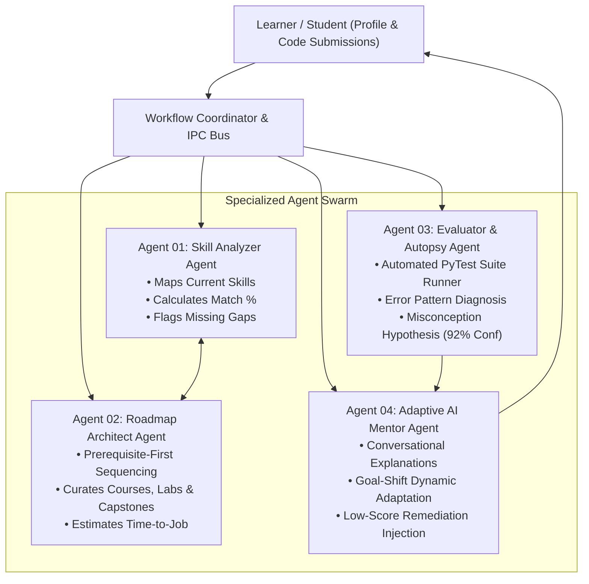

# 🚀 SkillTrace AI — Autonomous Multi-Agent Learning & Career Platform

> **SRCAS Hackathon 3.0 (#BuildTheFuture) Official Submission**  
> *Theme & Alignment: Addressing UN Sustainable Development Goal 4 (Quality Education) & Future of Work*  
> *UI Style & Visual Identity inspired by: [https://www.hackathon2026.in/](https://www.hackathon2026.in/)*

---

## 📌 Executive Summary & Problem Statement

Organizations and universities find it difficult to identify what skills their employees or students lack and what they need to learn to achieve their career goals. Traditional learning platforms provide the same monolithic courses to everyone without considering their existing skills, learning progress, or career interests.

**SkillTrace AI** is an AI-powered personalized learning platform that understands an individual's skills, identifies missing competencies, and dynamically recommends a personalized learning path to help them achieve their target career.

---

## 🌟 The Three Selected Innovations (Architecture Core)

Beyond baseline learning platform features, SkillTrace is powered by three core innovations:

| Innovation | Core Capability | Differentiating Value |
| :--- | :--- | :--- |
| **1. Root-Cause Failure Autopsy** | Investigates patterns in failed test cases, wrong answers, and runtime exceptions. | Differentiates syntax errors from mental-model misconceptions (e.g. sync vs async parsing) and synthesizes a targeted confirmation micro-challenge. |
| **2. Evidence-Weighted Skills** | Scores skills from observable proof rather than self-reported claims. | Transparent weighting: Practical Code Tests (45%), Projects (35%), Quizzes (20%), with confidence & authenticity audit trails. |
| **3. Backend Skill Proven** | Verifies practical engineering ability through hands-on tasks. | In-browser API sandbox where learners write REST endpoints, handle JSON parsing, validate inputs, and pass automated unit test suites. |

---

## 🤖 Multi-Agent AI System Architecture

SkillTrace is powered by four specialized, collaborating AI agents communicating over a real-time event bus:



1. **Skill Analyzer Agent**: Ingests user profile, past assessments, and verified credentials. Computes career matching percentage and flags critical missing skills.
2. **Roadmap Architect Agent**: Structures chronological milestones. Enforces prerequisites so foundational gaps (e.g., JavaScript ES6+) are resolved before advanced frameworks (React/Node.js).
3. **Evaluator & Autopsy Agent**: Runs sandboxed tests on student code submissions. When tests fail, it investigates the root cause and generates a targeted follow-up task.
4. **Adaptive AI Mentor Agent**: Contextual conversational tutor. Re-plans roadmaps in real time when a learner changes career goals or struggles on an assessment.

---

## 🎯 Sample Scenario Walkthrough (Pre-Configured Demo)

The application includes an instant **"Load Sample Scenario"** button to demonstrate the exact scenario:
* **Learner**: Arun Kumar (3rd Year Undergrad at Sri Ramakrishna College of Arts and Science)
* **Target Role**: **Full Stack Developer**
* **Current Skills**: Python (75%), SQL (70%), HTML & CSS (50%)
* **Missing Skills**: JavaScript (Missing), React (Missing), Node.js (Missing)
* **Initial Match Score**: **42%**
* **System Actions**:
  1. Skill Analyzer flags the 3 missing critical competencies.
  2. Roadmap Architect constructs a 4-Stage Pathway:
     * *Stage 1: JavaScript Engine & Asynchronous Architecture* (3-4 Weeks)
     * *Stage 2: Modern Frontend Systems with React* (4-5 Weeks)
     * *Stage 3: Scalable Server Architecture & Node.js* (4-5 Weeks)
     * *Stage 4: Full Stack Capstone & Automated CI/CD* (3-4 Weeks)
  3. AI Mentor guides the student on why Python + SQL intuition can be leveraged to accelerate JavaScript & Node learning.

---

## 🎨 UI / Design System (`hackathon2026.in` Aesthetic)

The user interface reflects the design language of the **SRCAS Hackathon 3.0 (`hackathon2026.in`)**:
* **Cyber Midnight Palette**: Deep space background (`#060813`), glassmorphic cards with translucent backdrop blur.
* **Vibrant Neon Gradients**: Electric cyan (`#06b6d4`, `#22d3ee`), ultraviolet (`#8b5cf6`), emerald (`#10b981`), and warning amber (`#f59e0b`).
* **Visual Status Elements**: Glowing agent activity indicators, live RPC message feeds, circular match score gauges, and confetti celebration triggers.

---

## 🚀 Quickstart & How to Run

### Method 1: Instant Server (Recommended)
You can start the native Node.js application server (zero external dependencies required):

```bash
node server.mjs
```

Then open your browser at:
👉 **`http://localhost:3000`**

### Method 2: Direct Browser Launch
You can also directly open `index.html` in Google Chrome, Microsoft Edge, or any modern web browser:
```bash
start index.html
```

---

## 🧪 Interactive Features to Test in the Demo

1. **One-Click Sample Scenario**: Click **"Full Stack Student (Official Sample)"** in the top navigation bar to reset to Arun Kumar's baseline scenario.
2. **Career Goal Adaptation**: Select a different role from the **Target Career Goal** dropdown (e.g. *AI / Machine Learning Engineer* or *Backend Specialist*) to observe the agents immediately re-analyzing and rebuilding the roadmap.
3. **Run Practical API Tests**: Switch to the **Practical API Lab** tab:
   * Click **[Run Correct Solution]** to see 4/4 automated tests pass and evidence recorded.
   * Click **[Run Buggy Submission]** to watch the **Root-Cause Failure Autopsy** diagnose the asynchronous JSON stream error with 92% confidence!
4. **AI Mentor Conversational Chat**: Open the floating **AI Mentor Assistant** in the bottom-right corner and try questions like:
   * *"Why is Node.js recommended for full stack?"*
   * *"How does Root-Cause Autopsy help me?"*
5. **Agent Swarm Monitor**: Switch to the **Agent Swarm** tab to view the 4 active agents and inspect the live JSON-RPC inter-agent communication logs.

---

## 👥 Hackathon Team & Acknowledgements
* **Organized for**: SRCAS Hackathon 3.0 (Sri Ramakrishna College of Arts and Science, Coimbatore)
* **In Collaboration with**: Microsoft & iGenius AI
* **Project**: SkillTrace AI — Autonomous Multi-Agent Learning & Career Development Platform

